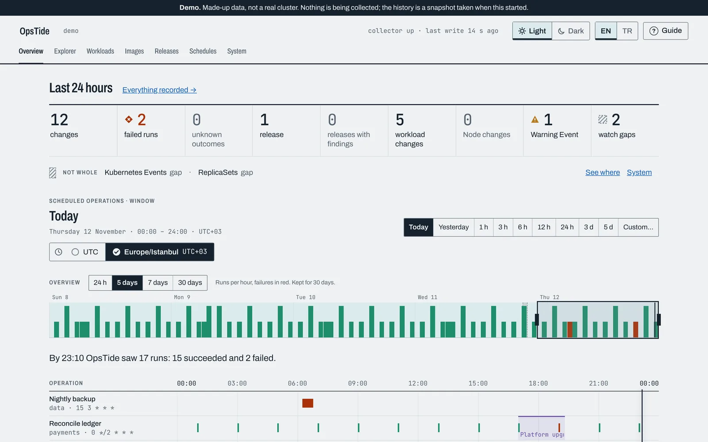
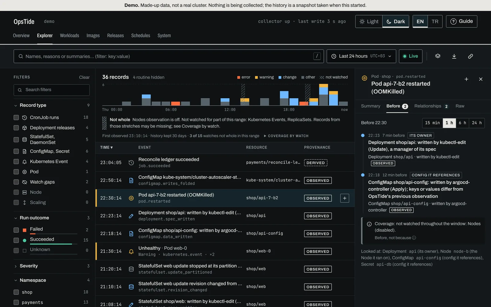
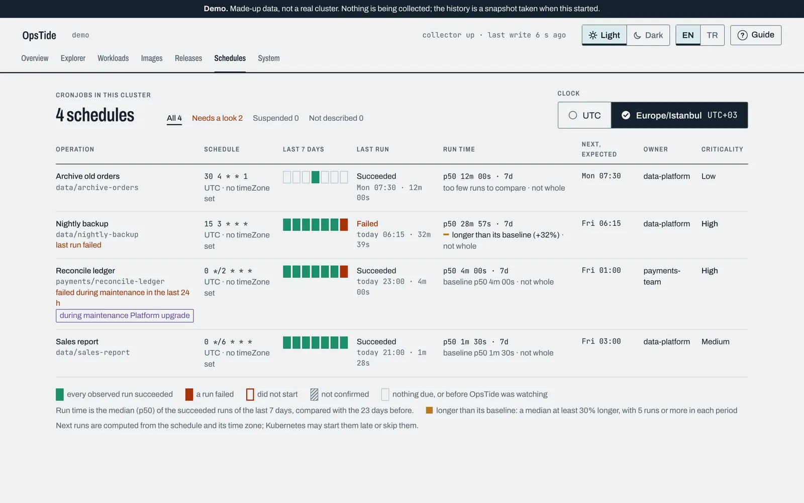
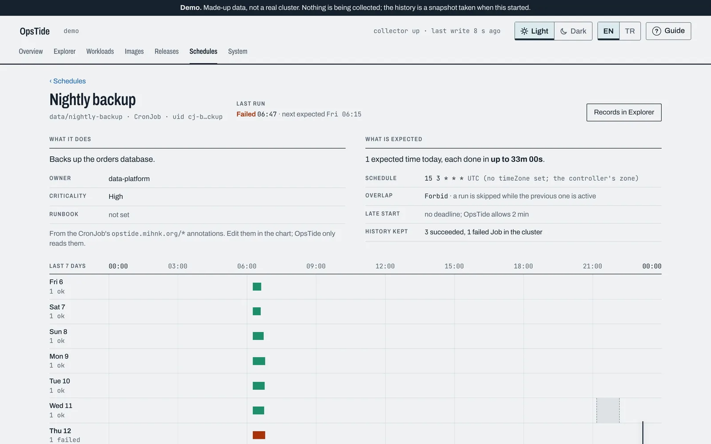
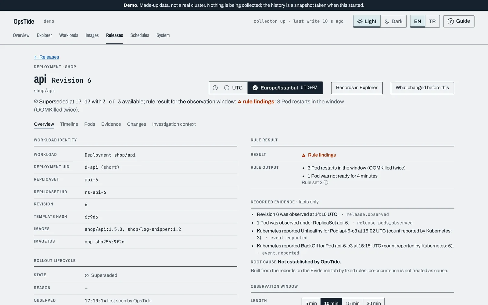

# OpsTide

[](https://github.com/mihnk/opstide/actions/workflows/ci.yml)
[](LICENSE)

**Your cluster's operational memory.** OpsTide runs inside a Kubernetes cluster,
watches CronJobs, Jobs, rollouts and configuration changes, and keeps a durable
record of what was expected to happen, what actually ran, and when it could not see.

It answers the morning questions without a VPN or a laptop left open: what ran
overnight, what failed, what changed before it, what is still to come today, and
whether the record has holes.

<picture>
  <source media="(prefers-color-scheme: dark)" srcset="docs/images/overview-dark.webp">
  
</picture>

> **Status:** early development (v0.1 in progress). Nothing is released yet; the
> image and the Helm chart are published with the first release.

## Try it in a minute

No cluster, kubeconfig or Docker needed: the demo serves a made-up history from a
temporary database and says so on every page. It needs Go and Node 22.

```bash
git clone https://github.com/mihnk/opstide && cd opstide
make demo-local    # then open http://127.0.0.1:8080
```

The interface is in English and Turkish, light and dark, and starts with a short guide.

## What it records

- **Scheduled work.** Every CronJob run, its outcome and duration against its own
  baseline, runs that should have happened and did not, and what is due next.
- **Releases and workloads.** Deployment, StatefulSet and DaemonSet revisions,
  whether each rollout completed, Pod restarts and OOMKills in the minutes after,
  and what changed from the previous revision.
- **Changes, and who wrote them.** Specs, schedules, replica targets, ConfigMaps
  and (if you turn it on) Secret metadata, with the field manager that wrote them
  (`argocd-controller`, `kubectl-edit`, `helm`). Values are never kept.
- **What changed before this.** For a failure, every change recorded on the same
  resource, its owners, the ConfigMaps it references and its Node in the hour before.
- **Kubernetes Events, images and Nodes.** Events as evidence, which images ran
  where at any past time, Node conditions.
- **Its own blind spots.** When a watch was not running, that stretch is a recorded
  gap, drawn on every page, and nothing inside it is called failed or missed.

<p>
  
  
</p>
<p>
  
  
</p>

## Principles

- **Observed, derived or unknown.** Every record says which it is. "This run was
  missed" is claimed only when the record was continuous.
- **Before, not because.** OpsTide shows what happened and what happened earlier.
  It never says why.
- **Read-only.** Only `list` and `watch`. It never changes the cluster and never
  requests a Secret's data, logs or exec.
- **Private by default.** One pod and one SQLite database on a volume. Nothing is
  sent out of the cluster, and no AI, Prometheus or Loki is required.

## Install

```bash
helm install opstide oci://ghcr.io/mihnk/charts/opstide -n opstide --create-namespace
kubectl -n opstide port-forward svc/opstide 8080:80    # then open http://127.0.0.1:8080
```

Sign in with the token the chart creates:

```bash
kubectl -n opstide get secret opstide-auth -o jsonpath='{.data.token}' | base64 -d; echo
```

The chart installs one pod (one writer), a 5 Gi volume and a ServiceAccount that
can only `list` and `watch`. Watching only some namespaces, Argo CD, Ingress,
NetworkPolicy and every value: [docs/install.md](docs/install.md).

## Describing a CronJob

Owners describe their jobs with annotations, committed through GitOps. OpsTide only reads them.

| Annotation | Meaning |
|---|---|
| `opstide.mihnk.org/name` | Friendly name |
| `opstide.mihnk.org/description` | What the job does and what a failure means |
| `opstide.mihnk.org/owner` | Owning team |
| `opstide.mihnk.org/criticality` | `low`, `medium`, `high` or `critical` |
| `opstide.mihnk.org/runbook` | `https://` link to the runbook |
| `opstide.mihnk.org/expected-duration` | Go duration, e.g. `4m` |

## How it is built

One Go process with client-go informers writes to SQLite (WAL) on a
PersistentVolume and serves the web UI and a read API on the same port. It runs
as one replica; high availability is not promised.

```
CronJob / Job / Pod / Deployment / ConfigMap watches ──► collector ──► SQLite (PVC)
                                                                          │
                                     browser ◄── web UI + /api/v1 ◄───────┘
```

## Documentation

| Guide | What it covers |
|---|---|
| [Install and configure](docs/install.md) | Chart, RBAC, values, the token, upgrading |
| [The web UI](docs/ui.md) | Each page, and how run time is compared |
| [Changes, ConfigMaps and Secrets](docs/configuration-changes.md) | The change ledger, what is kept and what turning on Secrets grants |
| [Maintenance windows](docs/maintenance-windows.md) | Declaring planned work so it reads as planned |
| [Image inventory](docs/image-inventory.md) | What ran where, at any past time |
| [Grafana annotations](docs/grafana.md) | Changes, failures and blind spots on your dashboards |
| [Metrics and alerting](docs/metrics.md) | `/metrics`, and alerting on a CronJob |
| [Read API](docs/api.md) | Every endpoint the UI uses |
| [How big it can get](docs/performance.md) | Measured on 500 CronJobs and 30 days |
| [Demo and development](docs/development.md) | kind demo, building, tests, the website |

Design notes: [releases](docs/M2.5-WORKLOAD-RELEASES.md),
[evidence](docs/M2.6-EVIDENCE.md), [workloads](docs/M2.7-WORKLOADS.md),
[explorer](docs/M2.8-EXPLORER.md).

## Security

OpsTide is read-only and keeps no Secret data or ConfigMap values. To report a
vulnerability, see [SECURITY.md](SECURITY.md).

## License

Apache 2.0. See [LICENSE](LICENSE).
